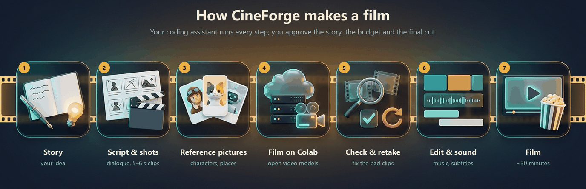

# CineForge · 影铸

**Turn a story idea into an AI film—with your coding assistant beside you.**

[中文](README.zh-CN.md) · [Setup guide](docs/en/getting-started.md) · [Plain-English glossary](docs/en/glossary.md)

Three original films, about 30 minutes each, made with open video models on rented Colab GPUs. **Click a clip to watch it with sound.** Everything you see was generated; no camera, no actors.

<table>
<tr>
<td width="50%" align="center"><a href="https://junwenxiong.github.io/cineforge/showcase/#battle"></a><br><sub><b>Starcore Dawn</b> · Mech shield vs. drone swarm</sub></td>
<td width="50%" align="center"><a href="https://junwenxiong.github.io/cineforge/showcase/#clash"></a><br><sub><b>Starcore Dawn</b> · Final clash</sub></td>
</tr>
<tr>
<td width="50%" align="center"><a href="https://junwenxiong.github.io/cineforge/showcase/#chase"></a><br><sub><b>Calico Signal</b> · Robot dog in the fruit market</sub></td>
<td width="50%" align="center"><a href="https://junwenxiong.github.io/cineforge/showcase/#echo"></a><br><sub><b>The Last Echo</b> · The voice on the tape</sub></td>
</tr>
</table>

**Cat recast (video-to-video):** real TV footage → cats, same motion & original dialogue (v2v). About 30 s each, 4–7 GPU-minutes per clip including retakes. [All clips on one page](https://junwenxiong.github.io/cineforge/showcase/).

<table>
<tr>
<td width="33%" align="center"><a href="https://junwenxiong.github.io/cineforge/showcase/#sanguo"></a><br><sub><b>三国 · 俺也一样</b></sub></td>
<td width="33%" align="center"><a href="https://junwenxiong.github.io/cineforge/showcase/#xiyou"></a><br><sub><b>西游 · 偷吃人参果</b></sub></td>
<td width="33%" align="center"><a href="https://junwenxiong.github.io/cineforge/showcase/#honglou"></a><br><sub><b>红楼 · 刘姥姥进大观园</b></sub></td>
</tr>
</table>

<sub>Music in the clips: Scott Buckley, CC BY 4.0 (scottbuckley.com.au). Films: 星核黎明 / Starcore Dawn, 三花信号 / Calico Signal, 残响 / The Last Echo. Cat recasts: fan re-imaginings of scenes from the CCTV series 三国演义 (1994), 西游记 (1986), 红楼梦 (1987), with their original dialogue.</sub>

## How long and how much?

These are **our own measurements from 2026-11-20**: one person, one Colab Pro+ account. They are not a promise for your account or computer.

| | 星核黎明 Starcore Dawn | 三花信号 Calico Signal | 残响 The Last Echo |
|---|---|---|---|
| Film length (before credits) | 33 min | 32 min | 29 min |
| Shots in the final cut | 366 | 331 | 320 |
| Video models | H3 | 229 H3 + 102 LTX-2.5 | 117 H3 + 203 LTX-2.5 |
| Measured GPU time | 4.2 GPU-hours¹ | 4.0 GPU-hours | 6.2 GPU-hours |
| Filming window² | about 3 hours | about 6.3 hours for both films together, on a shared farm | |
| Colab compute units (approx.)³ | about 110 | about 190–245 for both films | |
| In money (approx.)⁴ | about US$11 | about US$19–25 for both films | |

**One shot:** a 6-second H3 shot took a median **43 s** on one G4 GPU (RTX PRO 6000, 96 GB); a 6-second LTX-2.5 shot took a median **38 s**. Loading the models on a fresh Colab computer took about 4 minutes. Up to **4 Colab computers** ran at once (3× G4 + 1 H100).

<sub>¹ GPU generation time of the 265 shots filmed on the Colab farm; 101 more shots ran on a separate licensed Box machine and are not counted. All numbers come from each shot's job record and the farm logs.
² From the first to the last accepted shot arriving. Writing, picture-making and editing are not included; retakes are.
³ Filming window × the usage Colab displayed while the farm ran: about 30 units/hour with 3 G4 computers, about 39 with 4. Colab does not report usage per film.
⁴ At Colab's pay-as-you-go price of about US$10 per 100 compute units at the time of writing; check the current price. Image generation for reference pictures is billed separately by your image service.</sub>

Your total cost depends on your Colab plan, which computers are free, how many retakes you need and your image service. Start small and check your balance often.

## What is this?

You write a paragraph; your AI coding assistant uses CineForge to turn it into a script and reference pictures, then helps you rent powerful computers on Google Colab to film each shot. Together, you check for mistakes and edit the shots into a roughly 30-minute film with voices, music and subtitles. This is an early project: you guide the story, approve spending, and watch and listen before calling it finished.

## How it works

<p align="center"></p>

1. **Story:** Describe the people, setting and story you want.
2. **Script & shots:** Your assistant writes the dialogue and breaks scenes into short video clips, called shots.
3. **Reference pictures:** Make pictures that show what each character, prop and place should look like.
4. **Film shots on Colab:** Google's rented computers turn those pictures and instructions into moving scenes with sound.
5. **Check & retake:** Watch the clips and remake the ones with mistakes.
6. **Edit, music, subtitles:** Join the good clips, keep complete dialogue, add licensed music and time the subtitles.
7. **Film:** Watch the whole film once more before sharing it.

## What you need

- [ ] **A computer with [Python 3.10+](https://www.python.org/downloads/) and [ffmpeg](https://ffmpeg.org/download.html).** Python runs the tools; ffmpeg edits video and sound. Linux or [WSL](https://learn.microsoft.com/windows/wsl/install), which runs Linux on Windows, is recommended. [Setup instructions](docs/en/getting-started.md).
- [ ] **An AI coding assistant:** [Claude Code](https://code.claude.com/docs/en/overview), [Codex](https://developers.openai.com/codex/cli), or [Gemini CLI](https://geminicli.com/docs/). It reads the instructions and helps run the commands.
- [ ] **[Google Colab Pro/Pro+](https://colab.research.google.com/signup).** Colab lends you a remote computer; its GPU is the chip doing the heavy video work. A *compute unit* is Colab's credit for computer use, not a fixed number of minutes. Set your spending limit before starting and watch the balance. [Colab's explanation](https://research.google.com/colaboratory/faq.html).
- [ ] **A [Hugging Face account](https://huggingface.co/join).** This site hosts AI models—the software that generates video. Accept the [LTX-2.5 license](https://huggingface.co/Lightricks/LTX-2.5) and any extra model licenses required by your chosen setup.
- [ ] **An image generator for reference pictures.** Use a service you already have, or supply your own pictures; image generation may cost extra. [Picture setup](docs/en/getting-started.md).

## Quick start

Download this repository and open its `cineforge` folder in your assistant. Open a terminal there—a window where you paste commands. Install the tools using the setup guide above. These commands are for Linux/WSL.

0. **Set up once, then check your computer.** `init` makes a private settings file called `.env` and asks for your Hugging Face token. What you type stays hidden, and you never need to give the token again: the tools and your assistant read it from that file. `doctor` then lists what is ready and how to fix the rest.

   ```sh
   python3 tools/setup.py init
   python3 tools/setup.py doctor
   ```

   **You should see:** a list of `PASS`, `WARN` and `FAIL` lines, each problem with a `fix:` line under it. Fix every `FAIL`; a `WARN` is only needed for some tasks. Add `--venv` to `init` to also install the Python packages. [Setup details](docs/en/getting-started.md).

1. **Check that the local tools work.** This does not rent a computer or generate a film.

   ```sh
   python3 tools/smoke_test.py
   ```

   **You should see:** `PASS` messages ending with `PASS offline smoke test (no GPU or external network)`.

2. **Make an editable copy of the Starcore example.** Run this once; it will refuse to overwrite an existing copy.

   ```sh
   python3 tools/new_film.py starcore --example starcore
   ```

   **You should see:** `films/starcore`. Your script files are now in that folder.

3. **Check the script.** Ask your assistant to explain or adapt the story before making pictures.

   ```sh
   python3 tools/validate_film.py --film starcore
   ```

   **You should see:** `"errors": []`. Missing pictures are expected: the examples contain text only.

4. **Prepare pictures, then film three test shots.** Give your assistant this instruction:

   > Follow skills/cineforge/SKILL.md for starcore. Help me prepare the pictures and set up Colab using docs/en/render-farm.md. Use LTX if I do not have a licensed Box installation. Confirm my budget before spending. Show me three difficult test shots before filming the rest.

   After the pictures are ready, run:

   ```sh
   python3 tools/validate_film.py --film starcore --require-media
   ```

   **You should see:** no missing-picture errors. After the guided Colab setup, you should receive three short videos to watch and hear. Approve them before continuing; this command itself only checks files. [Filming instructions](docs/en/render-farm.md).

5. **Edit the accepted shots into a film.** Once filming and [review](docs/en/qa-and-retakes.md) are complete, prepare your licensed music and credits with the [editing guide](docs/en/editing.md), then run:

   ```sh
   python3 tools/film/rough_cut.py --film starcore --name final
   python3 tools/film/score_mix.py --film starcore --name final
   python3 tools/film/master.py --film starcore --name final
   ```

   **You should see:** `videos/starcore/final_master.mp4`. Watch it and check the dialogue, subtitles and credits. Wait for every upload to finish, disconnect and delete your Colab computers, then confirm that compute-unit use has stopped.

## Visual Studio + One-Click Google Colab (Local Web UI + Cloud Models)

Want the fastest setup—**local Web UI for assets/prompts + all models running on Google Colab (zero local GPU setup)**?

[](https://colab.research.google.com/github/junwenxiong/cineforge/blob/main/colab/CineForge_Colab_Worker.ipynb)

1. **Start the local Web UI + Colab farm coordinator (1 command):**
   ```sh
   # Local host mode (opens Web UI on http://127.0.0.1:8866 + auto farm tunnel for Colab)
   bash studio/start.sh --with-farm --port 8866

   # Or via Docker (cross-platform macOS / Windows / Linux)
   bash docker/run.sh --host --with-farm --port 8866

   # Optional: shareable guest mode (anonymous session isolation, 30s/clip limit)
   bash studio/start.sh --guest --public --port 8866
   ```
2. **Open the Colab compute notebook above** (recommended: Colab Pro/Pro+ **A100 80 GB / H100 / G4**):
   - Choose your model from the dropdown: **MiniMax-H3 (open-source ComfyUI 4-step, no Box needed)**, **LTX-2.5**, **LTX-2.5 V2V (cat recast)**, **RelayVSR X2**, or **MiniMax-H3 (Box)**.
   - Paste the `FARM_URL` and `FARM_TOKEN` printed in your terminal (or switch `RUN_MODE` to **Standalone** to test a single shot directly inside Colab without starting anything locally).
   - Generated MP4 clips automatically return to your local Web UI, and can also be previewed, uploaded, zipped/downloaded, or backed up to Google Drive directly inside Colab.
   - **Built-in Lite ComfyUI Workflow Editor**: open any project's Workflow Graph tab to switch curated node-graph presets (H3 4-step R2V/T2V, LTX-2.5 I2V, LTX-2.5 V2V, Multi-Model Film), drag nodes, toggle bypasses, tweak steps/seed/resolution inline, import/export standard ComfyUI JSON, and click **Queue Prompt** to dispatch straight to Colab.

See [studio/README.md](studio/README.md) for API routes, `#farm` monitoring, and security boundaries.

## Good to know

- This is an early toolkit, not a finished “make my movie” button. The public version has not been tested from a fresh setup through a complete film.
- You still review the shots. Some mistakes only become obvious when you watch the full clip or listen to its dialogue.
- H3's fast route needs a separately licensed DramaPie Box installation. Otherwise, use the LTX route, which still needs guided setup. [Model details](docs/en/models.md).
- We saw four Colab computers running at once on one account. That availability is not guaranteed.
- Pictures, music and finished films are not included. You must supply them and have permission to use them.

## Common mistakes we already fixed for you

The tools and instructions include safeguards for these problems. They reduce mistakes; they cannot guarantee perfect shots.

- **Faces on the backs of heads:** tell the model when a face must stay hidden. [Why this happens](docs/en/troubleshooting.md#back-views-and-duplicates).
- **Cats with two tails:** remove extra animals and extra views from reference pictures. [Reference-picture rules](docs/en/troubleshooting.md#back-views-and-duplicates).
- **Cloned people:** show each person only once in each reference picture. [Avoid duplicates](docs/en/troubleshooting.md#back-views-and-duplicates).
- **Faces suddenly filling the screen between shots:** choose how much of the person to show and avoid unwanted camera zooms. [Keep framing steady](docs/en/troubleshooting.md#sudden-close-ups).
- **Dialogue cut off:** choose the cut after the spoken line ends. [Keep complete sentences](docs/en/troubleshooting.md#speech-and-subtitles).
- **The upload connection dropping:** retry transfers and check received videos before accepting them. [Recover uploads](docs/en/troubleshooting.md#truncated-transfers).

## Licenses and safety

The code is [Apache-2.0](LICENSE). Models have different rules: [H3's license](https://huggingface.co/MiniMaxAI/MiniMax-H3/blob/main/LICENSE) excludes the US, EU, UK and South Korea and requires AI-generated labelling. [LTX-2.5](https://huggingface.co/Lightricks/LTX-2.5) requires accepting its license before downloading; this is called *gated access*.

Treat access tokens like passwords. Keep them only in the private `.env` file that `python3 tools/setup.py init` creates; never paste them into other project files or into chat. To replace your Hugging Face token, run `python3 tools/setup.py init --reset-hf`. Keep the Colab notebook—the page containing your code—with its tunnel address private. The tunnel connects Colab to your computer. [More safety details](SECURITY.md).

## Example films

These folders hold the **text-only scripts**; the clips at the top of this page come from the finished films.

- [Starcore Dawn / 星核黎明](examples/starcore/README.md) — the main example.
- [Calico Signal / 三花信号](examples/catfilm/README.md).
- [Echo / 残响](examples/echo/README.md).

## Help & contributing

Questions and fixes are welcome. Open an issue to report a problem, or a pull request (PR) to suggest a change. See [how to contribute](CONTRIBUTING.md).

[FAQ](docs/en/faq.md) · [Glossary](docs/en/glossary.md) · [Troubleshooting](docs/en/troubleshooting.md)
