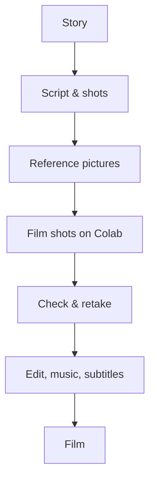

# CineForge · 影铸

**Turn a story idea into an AI film—with your coding assistant beside you.**

[中文](README.zh-CN.md) · [Setup guide](docs/en/getting-started.md) · [Plain-English glossary](docs/en/glossary.md)

## What is this?

You write a paragraph; your AI coding assistant uses CineForge to turn it into a script and reference pictures, then helps you rent powerful computers on Google Colab to film each shot. Together, you check for mistakes and edit the shots into a roughly 30-minute film with voices, music and subtitles. This is an early project: you guide the story, approve spending, and watch and listen before calling it finished.

## How it works



1. **Story:** Describe the people, setting and story you want.
2. **Script & shots:** Your assistant writes the dialogue and breaks scenes into short video clips, called shots.
3. **Reference pictures:** Make pictures that show what each character, prop and place should look like.
4. **Film shots on Colab:** Google's rented computers turn those pictures and instructions into moving scenes with sound.
5. **Check & retake:** Watch the clips and remake the ones with mistakes.
6. **Edit, music, subtitles:** Join the good clips, keep complete dialogue, add licensed music and time the subtitles.
7. **Film:** Watch the whole film once more before sharing it.

## What you need

- [ ] **A computer with [Python 3.10+](https://www.python.org/downloads/) and [ffmpeg](https://ffmpeg.org/download.html).** Python runs the tools; ffmpeg edits video and sound. Linux or [WSL](https://learn.microsoft.com/windows/wsl/install), which runs Linux on Windows, is recommended. [Setup instructions](docs/en/getting-started.md).
- [ ] **An AI coding assistant:** [Claude Code](https://code.claude.com/docs/en/overview), [Codex](https://developers.openai.com/codex/cli), or [Gemini CLI](https://geminicli.com/docs/). It reads the instructions and helps run the commands.
- [ ] **[Google Colab Pro/Pro+](https://colab.research.google.com/signup).** Colab lends you a remote computer; its GPU is the chip doing the heavy video work. A *compute unit* is Colab's credit for computer use, not a fixed number of minutes. Set your spending limit before starting and watch the balance. [Colab's explanation](https://research.google.com/colaboratory/faq.html).
- [ ] **A [Hugging Face account](https://huggingface.co/join).** This site hosts AI models—the software that generates video. Accept the [LTX-2.5 license](https://huggingface.co/Lightricks/LTX-2.5) and any extra model licenses required by your chosen setup.
- [ ] **An image generator for reference pictures.** Use a service you already have, or supply your own pictures; image generation may cost extra. [Picture setup](docs/en/getting-started.md).

## Quick start

Download this repository and open its `cineforge` folder in your assistant. Open a terminal there—a window where you paste commands. Install the tools using the setup guide above. These commands are for Linux/WSL.

1. **Check that the local tools work.** This does not rent a computer or generate a film.

   ```sh
   python3 tools/smoke_test.py
   ```

   **You should see:** `PASS` messages ending with `PASS offline smoke test (no GPU or external network)`.

2. **Make an editable copy of the Starcore example.** Run this once; it will refuse to overwrite an existing copy.

   ```sh
   python3 tools/new_film.py starcore --example starcore
   ```

   **You should see:** `films/starcore`. Your script files are now in that folder.

3. **Check the script.** Ask your assistant to explain or adapt the story before making pictures.

   ```sh
   python3 tools/validate_film.py --film starcore
   ```

   **You should see:** `"errors": []`. Missing pictures are expected: the examples contain text only.

4. **Prepare pictures, then film three test shots.** Give your assistant this instruction:

   > Follow skills/cineforge/SKILL.md for starcore. Help me prepare the pictures and set up Colab using docs/en/render-farm.md. Use LTX if I do not have a licensed Box installation. Confirm my budget before spending. Show me three difficult test shots before filming the rest.

   After the pictures are ready, run:

   ```sh
   python3 tools/validate_film.py --film starcore --require-media
   ```

   **You should see:** no missing-picture errors. After the guided Colab setup, you should receive three short videos to watch and hear. Approve them before continuing; this command itself only checks files. [Filming instructions](docs/en/render-farm.md).

5. **Edit the accepted shots into a film.** Once filming and [review](docs/en/qa-and-retakes.md) are complete, prepare your licensed music and credits with the [editing guide](docs/en/editing.md), then run:

   ```sh
   python3 tools/film/rough_cut.py --film starcore --name final
   python3 tools/film/score_mix.py --film starcore --name final
   python3 tools/film/master.py --film starcore --name final
   ```

   **You should see:** `videos/starcore/final_master.mp4`. Watch it and check the dialogue, subtitles and credits. Wait for every upload to finish, disconnect and delete your Colab computers, then confirm that compute-unit use has stopped.

## How long and how much?

These are **one person's measurements on 2026-11-20**, supplied from the original production run. They are not a promise for your account or computer.

| What we measured | What we saw |
|---|---|
| One 6-second shot on one G4 GPU, after the model was loaded | About 40 seconds with H3 through Box or LTX-2.5 distilled, its faster version |
| 《三花信号》 / Calico Signal | 331 shots: 244 H3 + 87 LTX |
| Filming window that day | About 15:40–19:25 on 3–4 G4 computers, including two rounds of retakes |
| Colab's displayed usage with 3 G4 computers | About 30 compute units per hour |
| Colab's displayed usage with 4 G4 computers | About 39 compute units per hour |

The filming window is not the time for writing, picture-making and final editing. Your total cost depends on your Colab plan, the computers available, extra attempts and image-service charges. We have not published a verified total bill. Start small and check your balance often.

## Good to know

- This is an early toolkit, not a finished “make my movie” button. The public version has not been tested from a fresh setup through a complete film.
- You still review the shots. Some mistakes only become obvious when you watch the full clip or listen to its dialogue.
- H3's fast route needs a separately licensed DramaPie Box installation. Otherwise, use the LTX route, which still needs guided setup. [Model details](docs/en/models.md).
- We saw four Colab computers running at once on one account. That availability is not guaranteed.
- Pictures, music and finished films are not included. You must supply them and have permission to use them.

## Common mistakes we already fixed for you

The tools and instructions include safeguards for these problems. They reduce mistakes; they cannot guarantee perfect shots.

- **Faces on the backs of heads:** tell the model when a face must stay hidden. [Why this happens](docs/en/troubleshooting.md#back-views-and-duplicates).
- **Cats with two tails:** remove extra animals and extra views from reference pictures. [Reference-picture rules](docs/en/troubleshooting.md#back-views-and-duplicates).
- **Cloned people:** show each person only once in each reference picture. [Avoid duplicates](docs/en/troubleshooting.md#back-views-and-duplicates).
- **Faces suddenly filling the screen between shots:** choose how much of the person to show and avoid unwanted camera zooms. [Keep framing steady](docs/en/troubleshooting.md#sudden-close-ups).
- **Dialogue cut off:** choose the cut after the spoken line ends. [Keep complete sentences](docs/en/troubleshooting.md#speech-and-subtitles).
- **The upload connection dropping:** retry transfers and check received videos before accepting them. [Recover uploads](docs/en/troubleshooting.md#truncated-transfers).

## Licenses and safety

The code is [Apache-2.0](LICENSE). Models have different rules: [H3's license](https://huggingface.co/MiniMaxAI/MiniMax-H3/blob/main/LICENSE) excludes the US, EU, UK and South Korea and requires AI-generated labelling. [LTX-2.5](https://huggingface.co/Lightricks/LTX-2.5) requires accepting its license before downloading; this is called *gated access*.

Treat access tokens like passwords. Never paste them into project files; use the private input method in the [setup instructions](docs/en/render-farm.md). Keep the Colab notebook—the page containing your code—with its tunnel address private. The tunnel connects Colab to your computer. [More safety details](SECURITY.md).

## Example films

These are **text-only scripts**. Film links are coming soon.

- [Starcore Dawn / 星核黎明](examples/starcore/README.md) — the main example.
- [Calico Signal / 三花信号](examples/catfilm/README.md).
- [Echo / 残响](examples/echo/README.md).

## Help & contributing

Questions and fixes are welcome. Open an issue to report a problem, or a pull request (PR) to suggest a change. See [how to contribute](CONTRIBUTING.md).

[FAQ](docs/en/faq.md) · [Glossary](docs/en/glossary.md) · [Troubleshooting](docs/en/troubleshooting.md)
