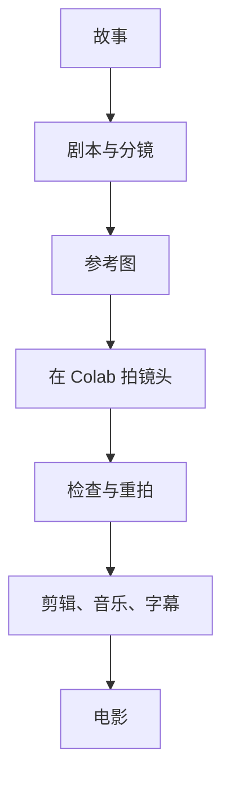

# CineForge · 影铸

**把故事想法拍成 AI 电影，让编程助手陪你一步步完成。**

[English](README.md) · [安装指南](docs/zh/getting-started.md) · [白话词汇表](docs/zh/glossary.md)

## 这是什么？

你写一段故事，AI 编程助手用影铸把它变成剧本和参考图，再帮你租用 Google Colab 上的高性能电脑，逐个镜头拍摄。你和助手一起检查错误、重拍，再剪成一部约 30 分钟、带人声、配乐和字幕的电影。这还是一个早期项目：故事由你把关，花钱前由你确认，最后也需要你看画面、听声音。

## 它怎么工作？



1. **故事：** 说清楚你想拍的人物、地点和情节。
2. **剧本与分镜：** 助手写台词，把每场戏拆成一条条短视频，也就是镜头。
3. **参考图：** 画出角色、道具和场景应该长什么样。
4. **在 Colab 拍镜头：** 租来的 Google 电脑根据图片和文字，生成带声音的视频。
5. **检查与重拍：** 看一遍短片，把有错误的镜头重新生成。
6. **剪辑、音乐、字幕：** 拼接合格镜头，保留完整台词，加入已授权的音乐并对齐字幕。
7. **电影：** 分享前，再完整看一遍。

## 你需要准备什么？

- [ ] **一台装有 [Python 3.10+](https://www.python.org/downloads/) 和 [ffmpeg](https://ffmpeg.org/download.html) 的电脑。** Python 负责运行工具，ffmpeg 负责处理视频和声音。推荐 Linux 或 [WSL](https://learn.microsoft.com/windows/wsl/install)，后者能在 Windows 里运行 Linux。[安装方法](docs/zh/getting-started.md)。
- [ ] **一个 AI 编程助手：** [Claude Code](https://code.claude.com/docs/en/overview)、[Codex](https://developers.openai.com/codex/cli) 或 [Gemini CLI](https://geminicli.com/docs/)。它会读制作说明，帮你执行命令。
- [ ] **[Google Colab Pro/Pro+](https://colab.research.google.com/signup)。** Colab 提供远程电脑，其中的 GPU 芯片负责费算力的视频生成。*Compute unit（计算单位，简称 CU）* 是使用电脑消耗的点数，不等于固定几分钟。开工前定好花费上限，过程中查看余额。[Colab 官方说明](https://research.google.com/colaboratory/faq.html)。
- [ ] **一个 [Hugging Face 账号](https://huggingface.co/join)。** 这个网站存放 AI 模型，也就是生成视频的软件。先接受 [LTX-2.5 的许可](https://huggingface.co/Lightricks/LTX-2.5)，以及所选方案需要的其他模型许可。
- [ ] **一个生成参考图的工具。** 可以用你已有的生图服务，也可以自己准备图片；生图可能另收费。[参考图准备方法](docs/zh/getting-started.md)。

## 六步开始

下载仓库，在助手里打开 `cineforge` 文件夹。在这个文件夹里打开终端，也就是可以粘贴命令的窗口。先按上面的安装指南装好工具。以下命令适用于 Linux/WSL。

0. **一次性设置，再体检电脑。** `init` 会建一个私密设置文件 `.env`，并请你输入 Hugging Face 令牌。输入时屏幕不显示，以后也不用再输：工具和助手都从这个文件读取。`doctor` 会列出哪些已就绪、其余怎么修。

   ```sh
   python3 tools/setup.py init
   python3 tools/setup.py doctor
   ```

   **你应该看到：** 一列 `PASS`、`WARN`、`FAIL`，每个问题下面有一行 `fix:` 修法。`FAIL` 必须修好；`WARN` 只在部分环节需要。给 `init` 加上 `--venv` 可顺便装好 Python 依赖。[设置详情](docs/zh/getting-started.md)。

1. **检查本地工具能不能运行。** 这一步不租电脑，也不生成电影。

   ```sh
   python3 tools/smoke_test.py
   ```

   **你应该看到：** 一系列 `PASS`，最后一行是 `PASS offline smoke test (no GPU or external network)`。

2. **复制一份可以修改的《星核黎明》示例。** 只需运行一次；已有副本时，工具会拒绝覆盖。

   ```sh
   python3 tools/new_film.py starcore --example starcore
   ```

   **你应该看到：** `films/starcore`。剧本文件就在这个文件夹里。

3. **检查剧本。** 生图前，先让助手解释或改编这个故事。

   ```sh
   python3 tools/validate_film.py --film starcore
   ```

   **你应该看到：** `"errors": []`。显示缺少图片是正常的，因为示例只提供文字。

4. **准备图片，再试拍三个镜头。** 把这段话发给助手：

   > 按 skills/cineforge/SKILL.md 制作 starcore。帮我准备图片，并按 docs/zh/render-farm.md 配置 Colab。如果我没有已获许可的 Box，就用 LTX。花钱前先确认我的预算，先给我看最难的三条试拍，再拍其余镜头。

   图片准备好后运行：

   ```sh
   python3 tools/validate_film.py --film starcore --require-media
   ```

   **你应该看到：** 不再有缺图错误。跟随助手完成 Colab 设置后，你应该收到三段可以看画面、听声音的短片。你认可后再继续；上面的命令本身只检查文件。[拍摄说明](docs/zh/render-farm.md)。

5. **把合格镜头剪成电影。** 拍摄和[抽检](docs/zh/qa-and-retakes.md)完成后，按[剪辑指南](docs/zh/editing.md)备好已授权音乐、填好署名，再运行：

   ```sh
   python3 tools/film/rough_cut.py --film starcore --name final
   python3 tools/film/score_mix.py --film starcore --name final
   python3 tools/film/master.py --film starcore --name final
   ```

   **你应该看到：** `videos/starcore/final_master.mp4`。打开检查台词、字幕和署名。等所有视频上传完，再断开并删除自己的 Colab 电脑，确认计算点数不再消耗。

## 要多久？要多少钱？

下面是**一位使用者在 2026-11-20 的实测记录**，由原制作项目提供。不是对你的账号或电脑作出的承诺。

| 测了什么 | 当时看到的结果 |
|---|---|
| 一台 G4 GPU 生成一个 6 秒镜头，模型已加载 | Box 上的 H3，或 LTX-2.5 distilled（较快的版本），约 40 秒 |
| 《三花信号》 / Calico Signal | 331 镜：244 镜 H3 + 87 镜 LTX |
| 当天拍摄时段 | 约 15:40–19:25，使用 3–4 台 G4，包含两轮重拍 |
| 3 台 G4 时 Colab 显示的消耗 | 约 30 CU/小时 |
| 4 台 G4 时 Colab 显示的消耗 | 约 39 CU/小时 |

拍摄时段不包含写作、生图和最后剪辑的全部时间。总费用取决于你的 Colab 套餐、能分到的电脑、额外尝试次数和生图服务费用。目前没有发布核实过的整片总账。先小规模试拍，过程中常看余额。

## 开始前知道这些就好

- 这是早期工具箱，还不是按一下“帮我拍电影”就能完成的产品。公开版尚未从全新环境开始验证完整出片。
- 镜头仍需你检查。有些错误只有看完整段视频或听台词才能发现。
- 快速 H3 方案需要另行取得许可的 DramaPie Box。没有 Box 就走 LTX，仍需跟随说明配置。[模型详情](docs/zh/models.md)。
- 我们曾在一个账号上同时开四台 Colab 电脑，不代表每个账号都能做到。
- 仓库不附图片、音乐或成片。你需要自行准备，并确认自己有权使用。

## 我们已经替你处理过的常见坑

工具和说明中已加入针对这些问题的办法，能减少错误，但不能保证每镜都完美。

- **后脑勺上画了一张脸：** 明确告诉模型，背影里不能看见脸。[原因与处理](docs/zh/troubleshooting.md#背影分身)。
- **猫长出两条尾巴：** 参考图不要混入第二只动物或第二个视角。[参考图规则](docs/zh/troubleshooting.md#背影分身)。
- **同一个人变成两个人：** 每张参考图中，每个主体只出现一次。[避免分身](docs/zh/troubleshooting.md#背影分身)。
- **切镜后大脸突然怼满画面：** 先定好要拍到人物哪里，再限制不必要的镜头推进。[保持景别稳定](docs/zh/troubleshooting.md#突然怼脸)。
- **话没说完就被剪掉：** 等台词说完再决定剪点。[保住完整台词](docs/zh/troubleshooting.md#台词字幕)。
- **上传连接中途断掉：** 重试传输，收到视频后先检查完整性。[恢复上传](docs/zh/troubleshooting.md#传输截断)。

## 许可与安全

代码采用 [Apache-2.0](LICENSE)。模型另有规则：[H3 许可](https://huggingface.co/MiniMaxAI/MiniMax-H3/blob/main/LICENSE)不覆盖美国、欧盟、英国、韩国，并要求标注 AI 生成。[LTX-2.5](https://huggingface.co/Lightricks/LTX-2.5)需要先接受许可才能下载，这叫 *gated access（受限访问）*。

把访问令牌当作密码。令牌只放在 `python3 tools/setup.py init` 创建的私密 `.env` 文件里，不要粘贴进其他项目文件或聊天窗口。要更换 Hugging Face 令牌，运行 `python3 tools/setup.py init --reset-hf`。Colab notebook 是放代码的网页，其中有你的隧道地址，要保持私密；隧道就是 Colab 连回你电脑的通道。[更多安全说明](SECURITY.md)。

## 示例电影

这里提供的是**文字剧本**。成片链接即将补充（coming soon）。

- [《星核黎明》 / Starcore Dawn](examples/starcore/README.md)：主示例。
- [《三花信号》 / Calico Signal](examples/catfilm/README.md)。
- [《残响》 / Echo](examples/echo/README.md)。

## 求助与参与

欢迎提问题和修复建议。用 issue 报告问题，用 pull request（简称 PR）提交修改建议。见[贡献说明](CONTRIBUTING.md)。

[常见问题](docs/zh/faq.md) · [词汇表](docs/zh/glossary.md) · [排障指南](docs/zh/troubleshooting.md)
